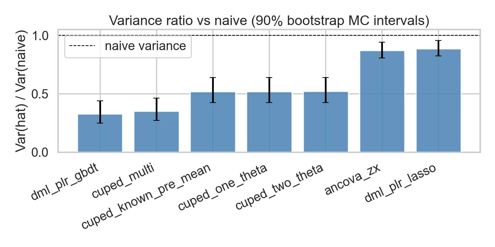
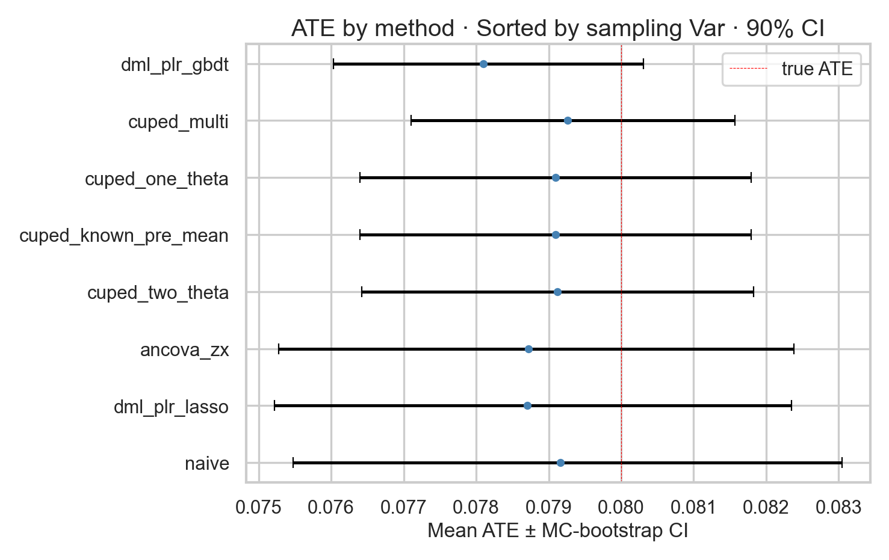
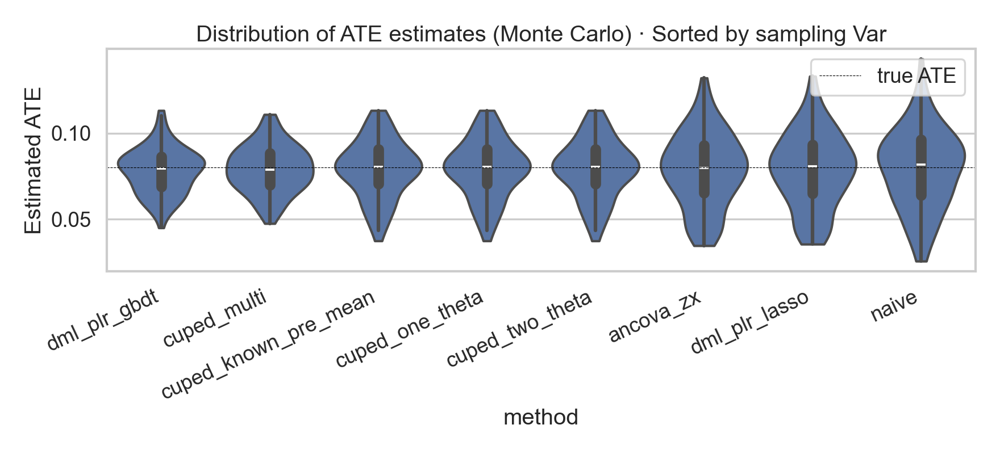

# Variance Reduction in Randomized Experiments: CUPED and MLRATE

A difference in means is an unbiased estimator of the average treatment effect (ATE) in a randomized experiment, and it is noisy when units differ a lot before the experiment starts. A pre-period outcome and covariates measured before assignment can predict much of the post-period outcome.

This repository simulates an ad-style randomized controlled trial (RCT) and compares estimators that use that information to shrink the sampling variance of the ATE. Every estimator targets the same treatment effect. They differ in how much predictable variation they remove.

## Simulation

```bash
python3 run_simulation.py
```

Tables and figures are written to `output/`. The numbers in this README come from one Monte Carlo run of the settings in `config.py`. Changing the sample size, the noise, or the number of replications can change which estimator has the smallest variance. The reason each method reduces variance stays the same.

## What is being estimated

Each unit has a post-period outcome $y_{\mathrm{post}}$, a binary treatment $w \in \lbrace 0,1 \rbrace$, a pre-period outcome $y_{\mathrm{pre}}$, and features $z$. Treatment is assigned by an independent coin flip, so it is independent of $y_{\mathrm{pre}}$ and $z$. The ATE on the post-period outcome is

$$
\tau = \mathbb{E}[y_{\mathrm{post}} \mid w{=}1] - \mathbb{E}[y_{\mathrm{post}} \mid w{=}0].
$$

In the simulator both periods share a nonlinear baseline $\mu(z)$. Independent noise is added to each period, and the post-period outcome adds a unit-level effect $\tau(z)w$ whose sample average is $\tau$:

$$
y_{\mathrm{pre}} = \mu(z) + \varepsilon_{\mathrm{pre}},
\qquad
y_{\mathrm{post}} = \tau(z) w + \mu(z) + \varepsilon_{\mathrm{post}}.
$$

Because $\mu(z)$ is shared, $y_{\mathrm{pre}}$ is correlated with $y_{\mathrm{post}}$, and $y_{\mathrm{pre}}$ does not contain $\tau(z)$. Because $\mu(z)$ and $\tau(z)$ are nonlinear, a straight line in $z$ leaves structure behind.

## Methods

### Naive estimator

$$
\hat\tau_{\mathrm{naive}} = \bar y_{\mathrm{post},1} - \bar y_{\mathrm{post},0}.
$$

This is the reference. It uses only $y_{\mathrm{post}}$ and $w$.

### CUPED

Controlled-experiment Using Pre-Experiment Data (CUPED; Deng et al., 2013) reduces the effect of chance baseline imbalance on the estimated treatment effect. It adjusts the post-period outcome with a pre-period outcome and then takes the same difference in means. With a slope $\theta$ and a center $\mu_{\mathrm{pre}}$ that is the same for both arms,

$$
y^{\mathrm{adj}}_i = y_{\mathrm{post},i} - \theta\bigl(y_{\mathrm{pre},i} - \mu_{\mathrm{pre}}\bigr),
\qquad
\hat\tau(\theta) = \overline{y^{\mathrm{adj}}}_T - \overline{y^{\mathrm{adj}}}_C.
$$

The shared center cancels, and the estimate collapses to one line:

$$
\hat\tau(\theta) = \hat\tau_{\mathrm{naive}} - \theta \Delta_{\mathrm{pre}},
\qquad
\Delta_{\mathrm{pre}} = \bar y_{\mathrm{pre},T} - \bar y_{\mathrm{pre},C}.
$$

Under randomization $\mathbb{E}[\Delta_{\mathrm{pre}}]=0$, so the estimand is still $\tau$. In a finite sample $\Delta_{\mathrm{pre}}$ is usually not zero. Suppose the treated group happens to have a higher pre mean ($\Delta_{\mathrm{pre}}>0$) and pre predicts post ($\theta>0$). Part of $\hat\tau_{\mathrm{naive}}$ then comes from that baseline gap. Subtracting $\theta\Delta_{\mathrm{pre}}$ takes that part out, so the adjusted estimate is closer to the contrast you would see if the pre means matched in that draw.

If $\Delta_{\mathrm{pre}}=0$, the adjustment is zero and CUPED equals the naive estimate for that draw. The smaller variance shows up across repeated experiments. In one experiment you still report a single estimate, and its standard error is smaller than the naive standard error because that sampling distribution is tighter.

For a fixed slope, $\hat\tau(\theta)$ is a difference in means of $y_{\mathrm{post}}-\theta y_{\mathrm{pre}}$. Given the assignment, its variance is the unit variance times a factor that does not depend on $\theta$:

$$
\mathrm{Var}\bigl(\hat\tau(\theta)\bigr)
= \mathrm{Var}(y_{\mathrm{post}}-\theta y_{\mathrm{pre}})
\Bigl(\frac{1}{n_T}+\frac{1}{n_C}\Bigr).
$$

Minimizing $\mathrm{Var}(\hat\tau(\theta))$ is therefore the same as minimizing

$$
v(\theta)
= \mathrm{Var}(y_{\mathrm{post}}) -
2\theta \mathrm{Cov}(y_{\mathrm{post}}, y_{\mathrm{pre}}) +
\theta^2\mathrm{Var}(y_{\mathrm{pre}}).
$$

Set the derivative $v'(\theta) = -2\mathrm{Cov}(y_{\mathrm{post}}, y_{\mathrm{pre}}) + 2\theta\mathrm{Var}(y_{\mathrm{pre}})$ to zero:

$$
\theta^\star = \frac{\mathrm{Cov}(y_{\mathrm{post}}, y_{\mathrm{pre}})}{\mathrm{Var}(y_{\mathrm{pre}})}.
$$

That is the regression of post on pre. Substituting it back into $v(\theta)$ leaves $\mathrm{Var}(y_{\mathrm{post}})(1-\rho^2)$, with $\rho = \mathrm{Corr}(y_{\mathrm{post}}, y_{\mathrm{pre}})$. The arm-size factor is common to both estimators, so

$$
\mathrm{Var}\bigl(\hat\tau(\theta^\star)\bigr) = \mathrm{Var}(\hat\tau_{\mathrm{naive}}) (1-\rho^2).
$$

The fraction of variance removed is the fraction of post-period variance linearly explained by the pre-period outcome. `cuped_one_theta` plugs in the sample slope. Estimating $\theta$ changes the ratio by a smaller-order term.

Which shared $\mu_{\mathrm{pre}}$ you use does not matter for the point estimate: a constant shift $\theta\mu_{\mathrm{pre}}$ cancels between arms. Centering inside each arm does matter, and it destroys the adjustment. If $\mu_{\mathrm{pre}}$ is the pre mean of unit $i$'s own arm, the centered pre-period averages to zero inside each arm, so

$$
\hat\tau = \hat\tau_{\mathrm{naive}}
$$

in every dataset, for any slope. The variance is then the naive variance. Standard CUPED centers on one common pre mean so that $\Delta_{\mathrm{pre}}$ stays in the formula.

### ANCOVA

Analysis of covariance (ANCOVA) regresses the post-period outcome on treatment, the centered features, and their interaction:

$$
y_{\mathrm{post}} = \alpha + \tau w + \beta^\top (z - \bar z) + w \bigl(\gamma^\top (z - \bar z)\bigr) + \varepsilon.
$$

$\hat\tau$ is the coefficient on $w$. Centering keeps that coefficient equal to the average treatment effect. $\gamma$ lets the slope on $z$ differ by arm. If the conditional mean is nonlinear in $z$, this linear model leaves residual structure behind.

### MLRATE

The machine learning regression-adjusted treatment effect estimator (MLRATE; Guo et al., 2021) uses pre-treatment information to predict the post-period outcome. The part of that outcome the prediction captures is baseline variation. Removing that predictable part leaves a less noisy estimate of the average treatment effect.

The starting point is Lin's interacted regression (Lin, 2013) on the pre-treatment covariates $x = (y_{\mathrm{pre}}, z)$:

$$
y_{\mathrm{post}} = \alpha + \tau w + \beta^\top x + w (\gamma^\top x) + \varepsilon.
$$

When $x$ is centered, the coefficient on $w$ is the average treatment effect. A linear equation in $x$ cannot follow a nonlinear relationship, or interactions among the covariates, so a straight line leaves predictable variation behind.

MLRATE replaces the vector $x$ with one prediction of the observed post-period outcome. A machine learning model is trained on the pre-treatment covariates only. Treatment is not an input. This comparison uses gradient boosting. The fitted values are

$$
\hat y = g(y_{\mathrm{pre}}, z).
$$

The function $g$ is that fit of the observed $y_{\mathrm{post}}$. Treatment is not an argument of $g$, so the prediction averages over the treatment assignments in the training data.

The prediction is cross-fit. The sample is split into folds. Each unit's $\hat y$ comes from a model trained on the other folds, so the prediction is not fit to the same outcome noise used to estimate $\tau$. Center $\hat y$ and fit

$$
y_{\mathrm{post}} = \alpha + \tau w + \beta (\hat y - \bar{\hat y}) + \gamma  w (\hat y - \bar{\hat y}) + \varepsilon.
$$

$\hat\tau$ is the coefficient on $w$. Because $\hat y - \bar{\hat y}$ has mean zero, the interaction averages out and that coefficient is the average treatment effect. The interaction lets the adjustment differ by arm when $\tau(z)$ varies.

The slopes $\beta$ and $\gamma$ are estimated rather than fixed at 1. Subtracting $\hat y$ from $y_{\mathrm{post}}$ would assume a slope of 1, and a poor prediction would then add noise. A useful prediction soaks up baseline variation and the residual variance of $\hat\tau$ falls. A prediction that does not track the outcome gets slopes near zero, and the fit falls back toward the difference in means.

## Estimators in the comparison

Every estimator below targets the same $\tau$. They differ in which pre-treatment information they use.

| Estimator | Adjustment | When it helps |
| --- | --- | --- |
| `cuped_one_theta` | One pooled pre→post slope, common center | Pre and post move together linearly |
| `cuped_two_theta` | Separate slopes by arm, still one common center | The pre→post slope differs by arm; estimating two slopes costs a little precision |
| `cuped_multi` | Several pre-period columns, one pooled linear fit | Those columns carry predictive information that a single $y_{\mathrm{pre}}$ misses |
| `ancova` | OLS of $y_{\mathrm{post}}$ on $w$, centered $z$, and their interaction | A straight line in $z$ captures the outcome, and the slope may differ by arm |
| `mlrate` | Cross-fit prediction $\hat y = g(y_{\mathrm{pre}}, z)$, then Lin regression on centered $\hat y$ | The baseline or the effect is nonlinear in the covariates |

## Simulation run

Settings: 10,000 units per experiment, 200 independent experiments, true average $\tau = 0.08$, with a nonlinear unit-level deviation $\tau(z)$ around that average. Across experiments, $\rho = \mathrm{Corr}(y_{\mathrm{post}}, y_{\mathrm{pre}})$ has mean $0.695$ (standard deviation $0.006$). Then $1-\bar\rho^2 \approx 0.517$. Scalar CUPED lands at $0.488$, close to that benchmark.

Rows are ordered by sampling variance of $\hat\tau$, smallest first. `var_vs_naive` is that variance divided by the naive variance. Values below 1 are variance reduction. The intervals in `output/summary_table.txt` are 90% bootstrap intervals for the Monte Carlo summaries. They describe uncertainty from using 200 experiments, not the confidence interval of one field experiment.

| Method | bias | rmse | var | var_vs_naive |
| --- | --- | --- | --- | --- |
| **mlrate** | 0.00009 | **0.00744** | **0.00006** | **0.281** |
| **cuped_multi** | 0.00052 | 0.00820 | 0.00007 | 0.340 |
| cuped_two_theta | −0.00010 | 0.00981 | 0.00010 | 0.488 |
| cuped_one_theta | −0.00011 | 0.00981 | 0.00010 | 0.488 |
| ancova | 0.00031 | 0.01330 | 0.00018 | 0.896 |
| **naive** | 0.00034 | **0.01405** | 0.00020 | 1.000 |

Relative variance, lowest on the left. The dashed line is the naive estimator.



Monte Carlo mean of $\hat\tau$, with a 90% bootstrap interval. The red line is the true ATE. Narrower intervals sit at the top because those estimators have smaller sampling variance.



The full set of $\hat\tau$ draws. The red line is the true ATE. Spread grows from left to right as sampling variance grows.



## Takeaways

- Bias is small next to RMSE for every method, so the error is sampling noise.
- With $\rho \approx 0.695$, scalar CUPED cuts the variance about in half, close to $1-\rho^2$. `cuped_multi` goes further, to **0.340×** the naive variance, because the extra pre-period columns carry information a single $y_{\mathrm{pre}}$ misses.
- `mlrate` is the most precise here, at **0.281×** naive. It predicts $y_{\mathrm{post}}$ from $y_{\mathrm{pre}}$ and $z$, then lets that adjustment differ by arm.
- ANCOVA, including the treatment interaction, reaches only **0.896×** naive. Most of $\tau(z)$ and nearly all of $\mu(z)$ are nonlinear in $z$, so the extra slope removes almost no residual variance.
- Separate slopes on $y_{\mathrm{pre}}$ (`cuped_two_theta`) match the single slope. The pre-period outcome does not contain $\tau(z)$, so a second pre-period slope has nothing extra to fit.

## Code

The math above is implemented in a few files. Names in the tables match the estimator names in the code.

| Piece | Where |
| --- | --- |
| Run the simulation and write `output/` | `run_simulation.py` |
| Sample size, noise, seeds, estimator list | `config.py` |
| Synthetic RCT, including $\mu(z)$ | `data/synthetic_ads.py` (`AdsRCTDGP`) |
| Extra pre-period columns for `cuped_multi` | `make_multivariate_y_pre` in the same file |
| Naive, CUPED, ANCOVA | `models/cuped.py` |
| MLRATE | `models/mlrate.py` |
| One $\hat\tau$ per experiment | `output/mc_draws.txt` |
| Bias, RMSE, variance, bootstrap intervals | `output/summary_table.txt` |
| Pre/post correlation | `output/rho_summary.txt` |

`MC_N_REPS` is the number of experiments. `MC_N_UNITS` is the number of units in each one. `MC_SEED_OFFSET` shifts the dataset seeds. `MC_BOOTSTRAP_SEED` only reseeds the interval calculation; the point estimates do not depend on it.

Centering scalar CUPED at a known pre mean matches `cuped_one_theta` exactly, since a shared center cancels, so that variant is not in the comparison.

## References

Deng, A., Xu, Y., Kohavi, R., and Walker, T. (2013). Improving the sensitivity of online controlled experiments by utilizing pre-experiment data. *Proceedings of the Sixth ACM International Conference on Web Search and Data Mining (WSDM)*, 123–132. <https://exp-platform.com/Documents/2013-02-CUPED-ImprovingSensitivityOfControlledExperiments.pdf>

Lin, W. (2013). Agnostic notes on regression adjustments to experimental data: Reexamining Freedman's critique. *Annals of Applied Statistics*, 7(1), 295–318. <https://arxiv.org/abs/1208.2301>

Guo, Y., Coey, D., Konutgan, M., Li, W., Schoener, C., and Goldman, M. (2021). Machine learning for variance reduction in online experiments. *Advances in Neural Information Processing Systems (NeurIPS)*, 34. <https://arxiv.org/abs/2106.07263>
